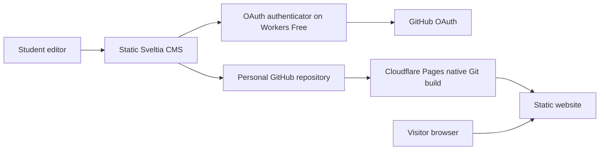

# Architecture and decisions

The production website is a static Astro build. GitHub stores content and media; Cloudflare Pages Free builds it after accepted commits. Sveltia CMS provides a graphical editor at `/admin/`. A separate, self-hosted Cloudflare Workers Free authenticator handles GitHub OAuth only during editor login. It does not serve public pages or process event transitions.

## Why this editing workflow

Sveltia is free, open source, and stores edits in Git. Its own [authenticator](https://github.com/sveltia/sveltia-cms-auth) supports GitHub users who need a normal sign-in flow rather than managing personal tokens. Hosting that authenticator avoids a hosted authentication seat allowance. The selected public repository uses the `public_repo` OAuth scope; do not grant workflow scope. OAuth scope can cover other public repositories the signed-in editor can access, so authorization is broader than a single content folder.

GitHub enforces repository write access. Students are individual collaborators. There is no claim of separate publisher, content-only, or advisor roles in this personal-repository setup. Existing collaborators can publish without the owner approving every edit; the owner still controls admitting new collaborators.

The CMS bundle is served with the site, with its package version locked. Authenticator source is pinned and vendored separately. Neither depends on a paid hosted CMS. Keep required third-party licenses with the source, and review dependency updates before adopting them.

Sveltia's [current installation guide](https://sveltiacms.app/en/docs/start) still identifies the CMS as beta. Version 0.258.1 is pinned here; test editor login, saving and deployment before any upgrade. The npm entry and normal lazy chunks are bundled locally. An optional upstream syntax-highlighting loader can still contact UNPKG inside the editor; public site pages load no editor resources. This free CDN dependency is disclosed in `COST_AUDIT.md`, and retained MIT notices are listed in `THIRD_PARTY_NOTICES.md`.

## Static event behavior

All published events have static detail pages. The visitor's browser compares their published end dates to the current time to place them in upcoming or archive views. Sorting, category and school-year filters, calendar views, and announcement expiry use deterministic code. No scheduled rebuild, background worker, or AI agent is needed as dates pass.

Use `America/New_York` for display and school-year rules. Known times include an explicit offset; sample events whose times were not supplied stay date-only rather than inventing a schedule. Static fallbacks preserve access when JavaScript is unavailable; precise automatic movement requires JavaScript and an accurate visitor clock.

## Instagram

The homepage uses the official Instagram profile embed. Instagram serves its current profile content, so the embedded feed does not need an AI model, scheduled job, API token, paid widget, or website rebuild when the account posts. Meta's [official embed plugin source](https://github.com/meta/meta-embeds-for-wordpress) supports profile URLs. Its official tokenless oEmbed endpoint returned the standard embed markup for this profile during development.

Event pages contain explicitly matched public post/reel URLs, editable as a list in the CMS. The profile widget does not create structured event pages or infer event dates from captions. Those remain editor-managed. Visitors choose to load an embed; direct links remain if Meta or the browser blocks it. No scraping is used. An API-based importer would require a professional account, Meta application authorization, server-side tokens and refresh/recovery; it is deliberately not required for the profile widget. See Meta's [official authorization documentation](https://developers.facebook.com/docs/instagram-platform/instagram-api-with-instagram-login/business-login/).

## Branding and factual content

The official school [About CMHS page](https://cmhs.cabarrus.k12.nc.us/357773_2) identifies purple, teal, and black as school colors and the Charger mascot. The initial theme therefore uses dark purple `#171329`, teal `#74ddd4`, and purple `#7254ba`, with editable centralized tokens. These exact shades are design choices, not verified official color specifications.

The simplified site uses text branding and a direct description of the class. Promotional mottos, poster artwork and generic slogan sections were removed at the owner's request. Class/event media uses public Instagram embeds or separately approved uploads. Private planning archives and their media are not published. Only current 2026–2027 public event summaries were added; older school-year folders and unconfirmed future plans were excluded. The public school contact is 1355 Cox Mill Road, Concord, NC 28027, 704-260-6600. The owner confirmed the Instagram profile and repository, and the public profile was subsequently viewed in the browser.

## Cost boundary

Public requests invoke no server code. Cloudflare documents [free unlimited static asset requests](https://developers.cloudflare.com/pages/functions/pricing/), provided Functions are not invoked. Only editor login uses the authenticator. Workers Free has a hard daily request quota and failure behavior documented in [Workers limits](https://developers.cloudflare.com/workers/platform/limits/). Keep that account on Free; a paid account is not an enforceable total $0 budget. See `COST_AUDIT.md` for the account checklist.

The project has no Actions workflow, database, mail service, payment system, AI call, analytics subscription, scheduled job, or paid storage binding. School-approved sign-up tools are external links.

## Security boundaries

- GitHub handles identity and repository authorization. The authenticator stores only its OAuth client secret server-side.
- Restrict the authenticator to the exact production hostname. Custom-domain changes require updating that allow list and retesting.
- Treat content as untrusted. Validate required fields, dates, image paths, and external URLs before build; render prose safely rather than accepting arbitrary scripts.
- Public media and Git history are public. Publish student information only with school permission. Private contact data does not belong in the repository.
- Browser-held editor access tokens are sensitive; sign out on shared devices. Never embed the owner's credentials in the bundle.
- Cloudflare credentials are not given to the CMS. Editors cannot change hosting billing through normal CMS controls.

## Deployment and verification status

Cloudflare's [native GitHub integration](https://developers.cloudflare.com/pages/configuration/git-integration/github-integration/) redeploys after repository pushes. Deploy this project's root with the documented build command and `dist` output; no SSR adapter is required. The free `pages.dev` address is the launch target. Optional [custom domains](https://developers.cloudflare.com/pages/configuration/custom-domains/) require registration in the Pages dashboard first; an apex uses a Cloudflare zone/nameservers, while a subdomain may use a CNAME at another DNS provider.

Local build and behavior checks do not verify production GitHub OAuth, Cloudflare account billing, or the actual automatic deploy pipeline. Those require the owner's accounts and the acceptance procedure in `DEPLOYMENT.md`. Do not claim the final integration works until those checks are recorded.
